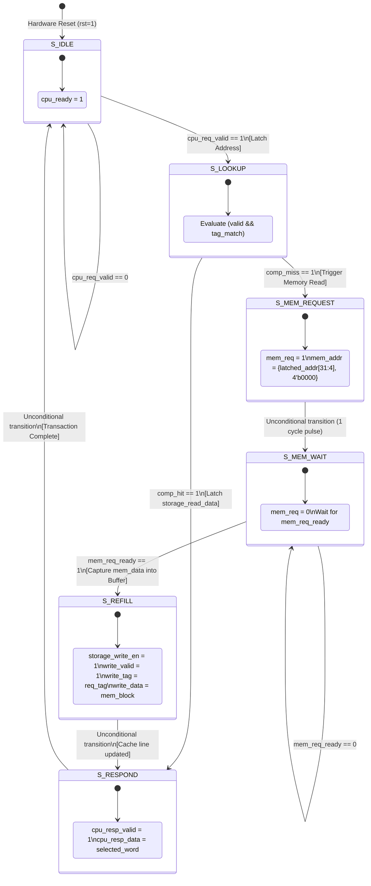

# Cache Controller FSM State Diagram & Protocol Specification

**Designer:** Manas (Controller Specialist & Integration Lead)  
**Module:** `rtl/cache_controller.v`  
**Architecture:** 6-State Moore-Mealy Synchronous Controller  

---

## 1. FSM State Encoding

The finite state machine utilizes a 3-bit binary state encoding:

| State Constant | 3-bit Encoding | Description | Moore Outputs Asserted |
| :--- | :---: | :--- | :--- |
| `S_IDLE` | `3'b000` | Awaiting incoming CPU read request | `cpu_ready = 1'b1` |
| `S_LOOKUP` | `3'b001` | Querying cache line; evaluating tag match & valid bit | `cpu_ready = 1'b0` |
| `S_MEM_REQUEST` | `3'b010` | Pulsing memory request with block-aligned address | `mem_req = 1'b1` |
| `S_MEM_WAIT` | `3'b011` | Waiting for main memory ready acknowledgment | `mem_req = 1'b0` (held) |
| `S_REFILL` | `3'b100` | Writing received 128-bit block into cache line | `storage_write_en = 1'b1`, `storage_write_valid = 1'b1` |
| `S_RESPOND` | `3'b101` | Delivering requested 32-bit word to CPU | `cpu_resp_valid = 1'b1`, `cpu_resp_data = word` |

---

## 2. Visual State Diagram



---

## 3. ASCII State Flow Chart

```
                        +----------------------+
                        |        RESET         |
                        +----------------------+
                                   |
                                   v
             +============================================+
             |                   S_IDLE                   |
+----------->|           cpu_ready = 1'b1                 |<-----------+
|            +============================================+            |
|                                  |                                   |
|                cpu_req_valid = 1 | latched_addr <= cpu_req_addr      |
|                                  v                                   |
|            +============================================+            |
|            |                  S_LOOKUP                  |            |
|            |          Tag Match & Valid Check           |            |
|            +============================================+            |
|                      /                        \                      |
|      comp_hit == 1  /                          \  comp_miss == 1     |
|                    v                            v                    |
|       +========================+    +========================+       |
|       |                        |    |     S_MEM_REQUEST      |       |
|       |                        |    | mem_req = 1            |       |
|       |                        |    | mem_addr = block_addr  |       |
|       |                        |    +========================+       |
|       |                        |                |                    |
|       |                        |                v                    |
|       |                        |    +========================+       |
|       |                        |    |       S_MEM_WAIT       |       |
|       |                        |    | mem_req = 0            |       |
|       |                        |    | Wait for mem_req_ready |       |
|       |                        |    +========================+       |
|       |                        |                |                    |
|       |                        |                | mem_req_ready == 1 |
|       |                        |                v                    |
|       |                        |    +========================+       |
|       |                        |    |        S_REFILL        |       |
|       |                        |    | storage_write_en = 1   |       |
|       |                        |    | write_valid = 1        |       |
|       |                        |    +========================+       |
|       |                        |                |                    |
|       |                        |                v                    |
|       |    +============================================+            |
|       +--->|                 S_RESPOND                  |------------+
|            |             cpu_resp_valid = 1             |
|            |          cpu_resp_data = Word Mux          |
|            +============================================+
```

---

## 4. State-by-State Transition Matrix

| Current State | Condition / Input | Next State | Actions & Output Signals |
| :--- | :--- | :--- | :--- |
| **`S_IDLE`** | `cpu_req_valid == 1` | `S_LOOKUP` | `latched_addr <= cpu_req_addr`; `cpu_ready = 1` |
| **`S_IDLE`** | `cpu_req_valid == 0` | `S_IDLE` | Wait for CPU request; `cpu_ready = 1` |
| **`S_LOOKUP`** | `comp_hit == 1` | `S_RESPOND` | `cached_block <= storage_read_data`; `cache_hit_flag = 1` |
| **`S_LOOKUP`** | `comp_miss == 1` | `S_MEM_REQUEST` | `cache_miss_flag = 1`; prepare memory fetch |
| **`S_MEM_REQUEST`** | Unconditional | `S_MEM_WAIT` | Assert `mem_req = 1`; drive `mem_addr = {latched_addr[31:4], 4'b0000}` |
| **`S_MEM_WAIT`** | `mem_req_ready == 0` | `S_MEM_WAIT` | Deassert `mem_req = 0`; wait for memory |
| **`S_MEM_WAIT`** | `mem_req_ready == 1` | `S_REFILL` | `mem_block_buffer <= mem_data`; `cached_block <= mem_data` |
| **`S_REFILL`** | Unconditional | `S_RESPOND` | Assert `storage_write_en`, `storage_write_valid`, update Tag and Data in RAM |
| **`S_RESPOND`** | Unconditional | `S_IDLE` | Assert `cpu_resp_valid = 1`; drive 32-bit selected word onto `cpu_resp_data` |

---

## 5. Latency Analysis: Hit vs. Miss

### 5.1 Cache Hit Path Timing: 2 Clock Cycles Total
* **Cycle 1 (`S_IDLE` -> `S_LOOKUP`):** CPU asserts `cpu_req_valid`. Address is latched into `latched_addr`. Index is driven to cache storage array.
* **Cycle 2 (`S_LOOKUP` -> `S_RESPOND`):** Storage reads line combinationally; comparator asserts `hit`. Controller latches line into `cached_block` and transitions to `S_RESPOND`.
* **Cycle 3 (`S_RESPOND` -> `S_IDLE`):** Controller asserts `cpu_resp_valid` with word data for 1 cycle. Next transaction can be accepted on this cycle.

### 5.2 Cache Miss Path Timing (Assuming Memory Latency = $L$ cycles): $4 + L$ Clock Cycles Total
* **Cycle 1:** `S_IDLE` -> Address latched.
* **Cycle 2:** `S_LOOKUP` -> Tag mismatch or valid bit is 0 (Miss identified).
* **Cycle 3:** `S_MEM_REQUEST` -> Single-cycle pulse on `mem_req`, block-aligned address driven.
* **Cycles 4 to $(3 + L)$:** `S_MEM_WAIT` -> Memory fetches 128-bit block. Handshake asserts `mem_req_ready`.
* **Cycle $(4 + L)$:** `S_REFILL` -> 128-bit block written to `cache_storage` with tag and valid flag.
* **Cycle $(5 + L)$:** `S_RESPOND` -> 32-bit word delivered to CPU with `cpu_resp_valid = 1`.
* **Cycle $(6 + L)$:** `S_IDLE` -> Controller ready for next transaction.
