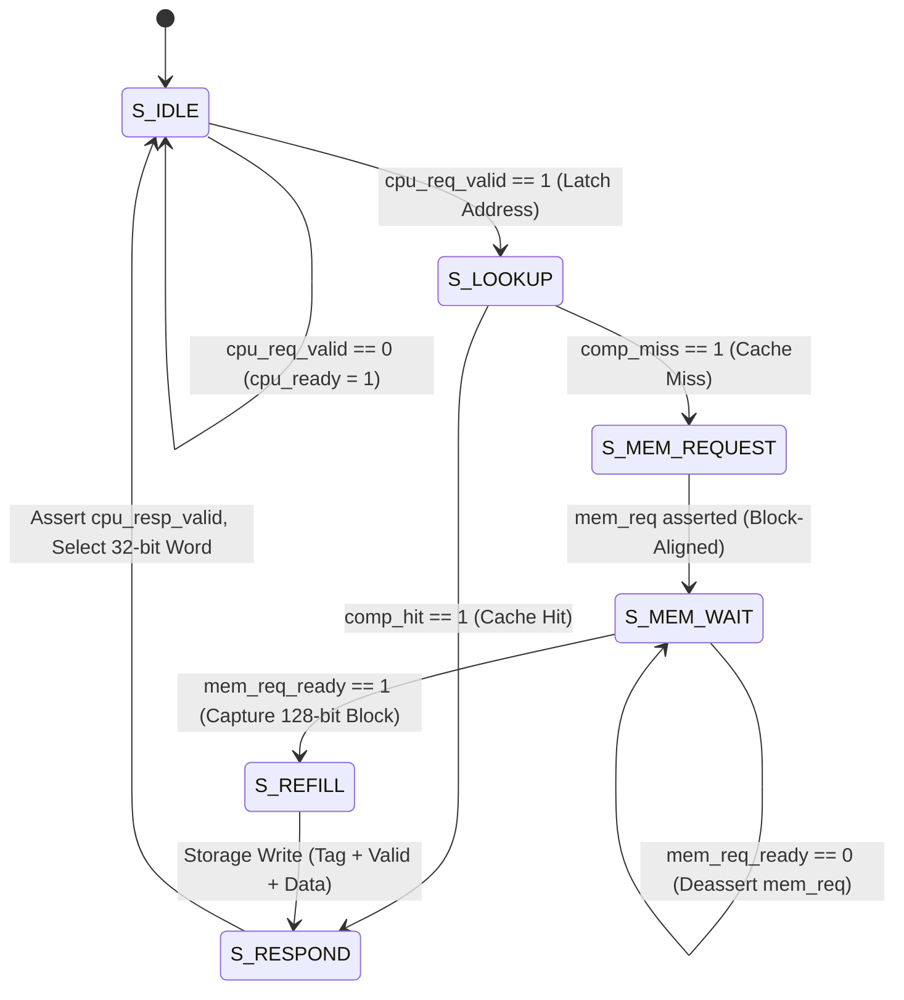

# Direct-Mapped Cache Controller: System Integration & Architecture Report

**Project Title:** Design and Analysis of a Direct-Mapped Cache Controller  
**Technical Role:** Integration Lead & Controller Specialist (MANAS)  
**Collaborators:** SANKALP (Address Decoder), TEJAS (Cache Storage), RONIT (Tag Comparator), ANANT (Memory Interface & Main Memory)  
**Target Architecture:** 32-bit Pipelined/Single-Cycle CPU Memory Subsystem  
**Design Status:** Verified & Synthesizable RTL  

---

## 1. System Architectural Overview

This project implements a high-performance, synthesizable, direct-mapped cache memory system configured for 32-bit memory addresses and 32-bit data words. The cache has a total capacity of 1 Kilobyte (KB) organized into 64 cache lines, with each line holding a 16-byte (128-bit) data block.

```
+-------------------------------------------------------------------------------------------------------+
|                                              cache_top                                                |
|                                                                                                       |
|    +-------------------+           +-----------------------+              +--------------------+      |
|    |  address_decoder  |           |     cache_storage     |              |   tag_comparator   |      |
|    |     (Sankalp)     |           |        (Tejas)        |              |      (Ronit)       |      |
|    +-------------------+           +-----------------------+              +--------------------+      |
|              ^                                 ^                                     ^                |
|              |                                 |                                     |                |
|              v                                 v                                     v                |
|    +-------------------------------------------------------------------------------------------+      |
|    |                                     cache_controller                                      |      |
|    |                                          (Manas)                                          |      |
|    +-------------------------------------------------------------------------------------------+      |
|                                                ^                                                      |
|                                                |                                                      |
|                                                v                                                      |
|                                    +-----------------------+                                          |
|                                    |   memory_interface    |                                          |
|                                    |        (Anant)        |                                          |
|                                    +-----------------------+                                          |
|                                                ^                                                      |
|                                                |                                                      |
|                                                v                                                      |
|                                    +-----------------------+                                          |
|                                    |      main_memory      |                                          |
|                                    |        (Anant)        |                                          |
|                                    +-----------------------+                                          |
+-------------------------------------------------------------------------------------------------------+
```

### 1.1 Cache Geometry Parameters
* **Cache Capacity:** $1\text{ KB} = 1024\text{ Bytes}$
* **Block Size:** $16\text{ Bytes} = 128\text{ bits}$
* **Number of Lines:** $\frac{1024\text{ Bytes}}{16\text{ Bytes/Line}} = 64\text{ Lines}$
* **Words per Block:** $\frac{16\text{ Bytes}}{4\text{ Bytes/Word}} = 4\text{ Words}$
* **Word Width:** $32\text{ bits}$
* **Address Width:** $32\text{ bits}$
* **Refill Policy:** Block refill (entire 16-byte block fetched on miss)
* **Access Mode:** Read-only cache architecture

### 1.2 Address Bit Field Decomposition
The 32-bit physical CPU address is partitioned as follows:
$$\underbrace{\text{Address[31:10]}}_{\text{Tag: 22 bits}} \quad \underbrace{\text{Address[9:4]}}_{\text{Index: 6 bits}} \quad \underbrace{\text{Address[3:2]}}_{\text{Word Select: 2 bits}} \quad \underbrace{\text{Address[1:0]}}_{\text{Byte Offset: 2 bits}}$$

* **Tag (`addr[31:10]` - 22 bits):** Uniquely identifies which memory block currently occupies the indexed cache line.
* **Index (`addr[9:4]` - 6 bits):** Addresses one of the 64 lines in the direct-mapped cache ($2^6 = 64$).
* **Block Offset (`addr[3:0]` - 4 bits):** Byte offset within the 16-byte block ($2^4 = 16$).
* **Word Select (`addr[3:2]` - 2 bits):** Selects one of the four 32-bit words within the 128-bit block:
  * `2'b00`: Word 0 (bits [31:0])
  * `2'b01`: Word 1 (bits [63:32])
  * `2'b10`: Word 2 (bits [95:64])
  * `2'b11`: Word 3 (bits [127:96])
* **Block-Aligned Memory Address:** `{addr[31:4], 4'b0000}`. Memory refills always operate on 16-byte aligned boundaries.

---

## 2. Technical Ownership & Submodule Interface Definitions

As Integration Lead and Controller Specialist (MANAS), I consumed the module interfaces provided by teammates without independently rewriting their internal logic.

| Module | Designer | Function | Interface Summary |
| :--- | :--- | :--- | :--- |
| `address_decoder.v` | **Sankalp** | Combinational Address Decoding | Input: `addr[31:0]`. Outputs: `tag[21:0]`, `index[5:0]`, `block_offset[3:0]`, `word_sel[1:0]`, `byte_offset[1:0]`, `block_addr[31:0]` |
| `cache_storage.v` | **Tejas** | 1 KB RAM Array (Valid, Tag, Data) | Read: `read_index[5:0]` -> `read_valid`, `read_tag[21:0]`, `read_data[127:0]`. Write: `write_en`, `write_valid`, `write_index`, `write_tag`, `write_data` |
| `tag_comparator.v` | **Ronit** | Validated Tag Comparison | Inputs: `tag_stored[21:0]`, `tag_req[21:0]`, `valid_stored`. Outputs: `hit`, `miss` |
| `memory_interface.v` | **Anant** | Bus Handshake & Request Protocol | Controller Side: `mem_req`, `mem_addr[31:0]`, `mem_req_ready`, `mem_data[127:0]`. Physical Side: `phy_mem_en`, `phy_mem_addr`, `phy_mem_ready`, `phy_mem_rdata` |
| `main_memory.v` | **Anant** | Multi-cycle Latency DRAM Model | Inputs: `clk`, `rst`, `mem_en`, `mem_addr[31:0]`. Outputs: `mem_ready`, `mem_rdata[127:0]` |
| `cache_controller.v` | **Manas** | 6-State FSM, Request Latching & Steering | Central coordinator interfacing CPU, Storage, Comparator, and Memory Interface |
| `cache_top.v` | **Manas** | Top-Level System Integration | Structural integration of all submodules, clock/reset tree, and diagnostic ports |

---

## 3. Cache Controller FSM Architecture

The controller is implemented as a 6-state finite state machine in `rtl/cache_controller.v`.



### Detailed State Specifications:
1. **`S_IDLE` (3'b000):**
   * The controller is idle and ready to accept new transactions (`cpu_ready = 1'b1`).
   * When `cpu_req_valid` is asserted, the 32-bit request address is latched into `latched_addr`.
   * Next state: `S_LOOKUP`.
2. **`S_LOOKUP` (3'b001):**
   * `cpu_ready` is deasserted (`1'b0`) to indicate the controller is busy.
   * `storage_read_index` indexes the cache storage for the requested set (`latched_addr[9:4]`).
   * Ronit's comparator checks if `valid_stored == 1'b1` and `tag_stored == latched_addr[31:10]`.
   * **Hit Path:** `comp_hit == 1'b1`. The 128-bit block is latched from storage into `cached_block`. Transition to `S_RESPOND`.
   * **Miss Path:** `comp_miss == 1'b1` (either `valid == 0` or tag mismatch). Transition to `S_MEM_REQUEST`.
3. **`S_MEM_REQUEST` (3'b010):**
   * Initiates memory fetch by driving `mem_req = 1'b1` and `mem_addr = {latched_addr[31:4], 4'b0000}`.
   * Single-cycle pulse avoids re-triggering main memory. Transition to `S_MEM_WAIT`.
4. **`S_MEM_WAIT` (3'b011):**
   * `mem_req` is deasserted to `1'b0`. Controller waits for `mem_req_ready`.
   * When `mem_req_ready` asserts, the incoming 128-bit block is captured into `mem_block_buffer` and `cached_block`.
   * Transition to `S_REFILL`.
5. **`S_REFILL` (3'b100):**
   * Storage write controls are asserted: `storage_write_en = 1'b1`, `storage_write_valid = 1'b1`, `storage_write_index = latched_addr[9:4]`, `storage_write_tag = latched_addr[31:10]`, `storage_write_data = mem_block_buffer`.
   * Transition to `S_RESPOND`.
6. **`S_RESPOND` (3'b101):**
   * The word selection multiplexer selects the requested 32-bit word using `latched_addr[3:2]`.
   * `cpu_resp_valid = 1'b1` and `cpu_resp_data = selected_word`.
   * Next state: `S_IDLE` (guaranteeing readiness for back-to-back CPU accesses).

---

## 4. Key Engineering & Architectural Decisions

1. **One-Request-At-A-Time Handshake & Backpressure:**  
   `cpu_ready` is asserted strictly in `S_IDLE`. As soon as a transaction starts, `cpu_ready` drops to 0. Any CPU holding a subsequent request is automatically backpressured until the current line refill and response finish.
2. **Request Address Latching:**  
   The address is latched immediately on transition from `S_IDLE`. External changes on `cpu_req_addr` during subsequent cycles have zero effect on the active transaction.
3. **Block Alignment Masking:**  
   Main memory addresses are calculated using bit-slicing `{latched_addr[31:4], 4'b0000}`, guaranteeing that all memory transactions fetch 16-byte aligned blocks regardless of CPU byte offsets.
4. **Non-Repeating Memory Protocol:**  
   `mem_req` is asserted only during `S_MEM_REQUEST` (for 1 cycle). In `S_MEM_WAIT`, `mem_req` is strictly 0. This prevents duplicate memory triggers during long DRAM latencies.
5. **Reset Invalidation Guarantee:**  
   Upon reset (`rst == 1`), `cache_storage` clears all 64 valid bits to 0. This prevents cold-start false hits caused by uninitialized RAM contents.

---

## 5. Verification Summary

All 7 required integration scenarios were verified in `tb/tb_cache_top_integration.v`:

| Test # | Test Case Scenario | Architectural Mechanism Verified | Status |
| :---: | :--- | :--- | :---: |
| **1** | First access to address `0x0000_1204` | Cold / Compulsory Miss, memory fetch, refill, response | **PASS** |
| **2** | Second access to `0x0000_1204` | Cache Hit, 1-cycle latency from cache, no memory fetch | **PASS** |
| **3** | Access to `0x0000_120C` (same block, Word 3) | Spatial Locality Hit, word selection mux (`2'b11`) | **PASS** |
| **4** | Access to `0x0010_1204` (same index `0x20`, different tag) | Conflict Miss, line replacement in cache | **PASS** |
| **5** | Re-access `0x0000_1204` after eviction | Evicted line causes compulsory re-fetch from memory | **PASS** |
| **6** | Hardware Reset Invalidation | All valid bits cleared to 0; no false hits | **PASS** |
| **7** | Consecutive Back-to-Back Requests & Backpressure | Handshake integrity without manual reset; `cpu_ready` interlock | **PASS** |

**Result:** 7 / 7 Integration Tests Passed (100% Success Rate).
